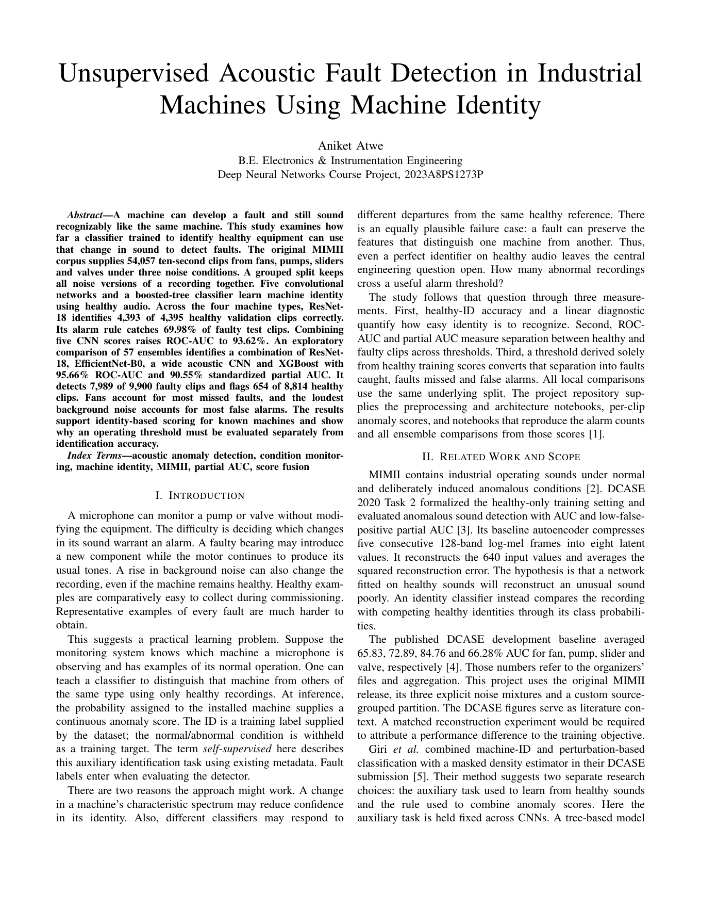
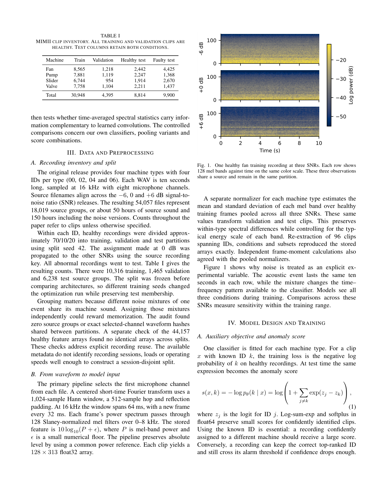
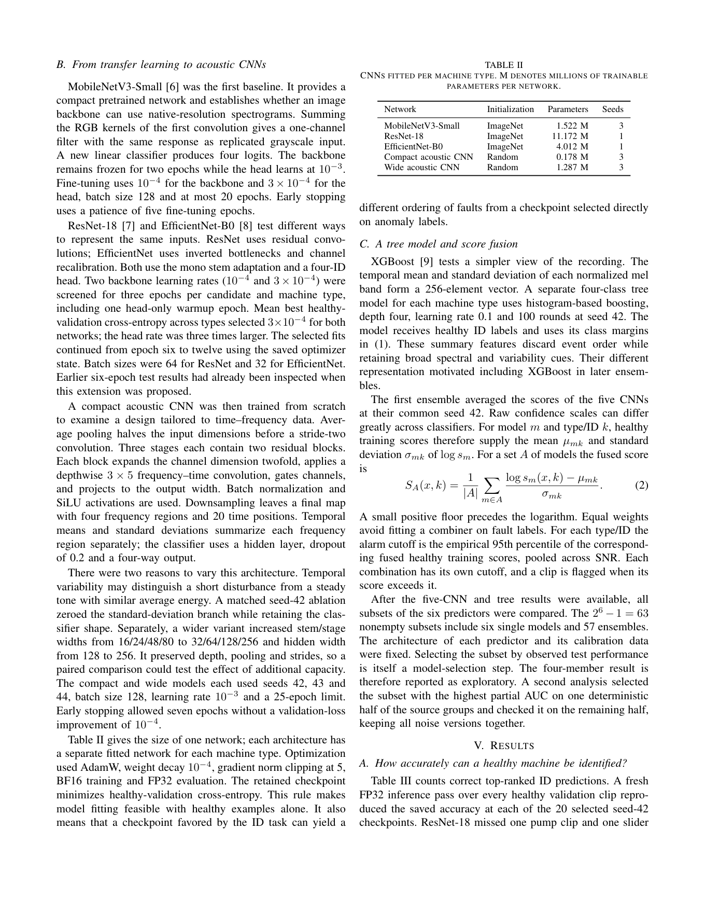
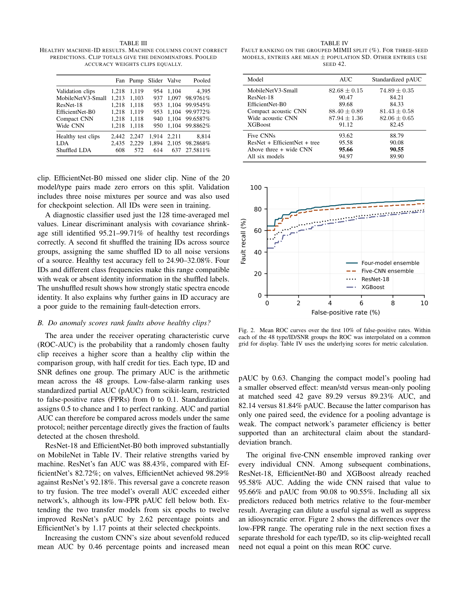
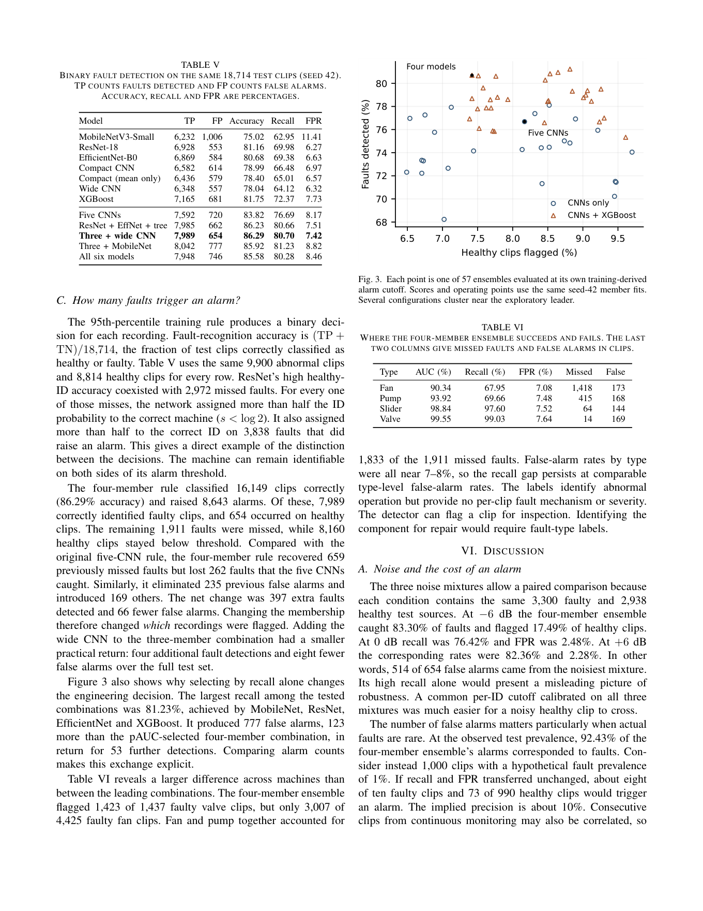
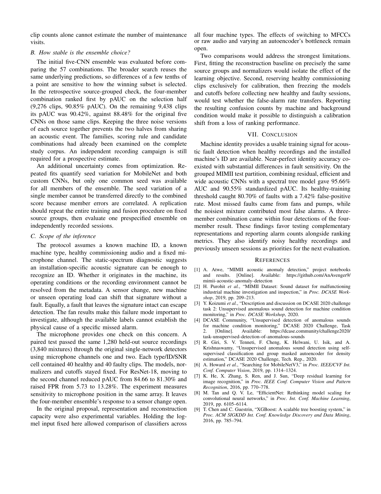

# Unsupervised Acoustic Fault Detection in Industrial Machines Using Machine Identity

[Download the six-page PDF](https://raw.githubusercontent.com/AnAvenger9/mimii-acoustic-anomaly-detection/main/docs/mimii_report.pdf)

